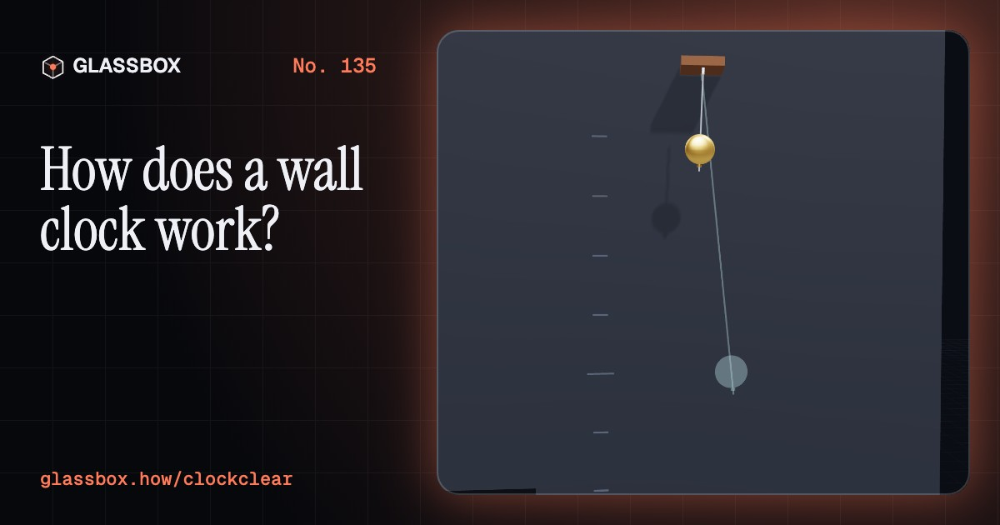
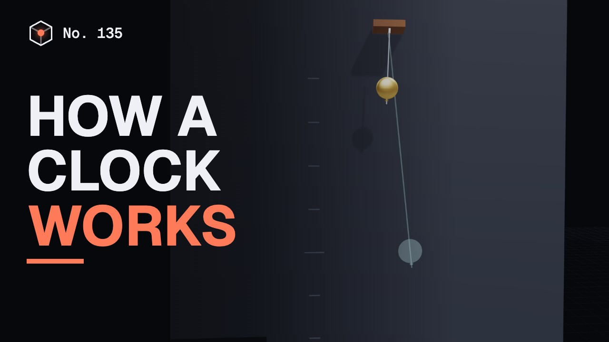
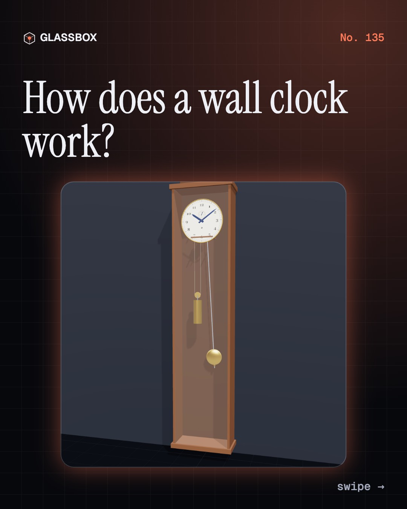
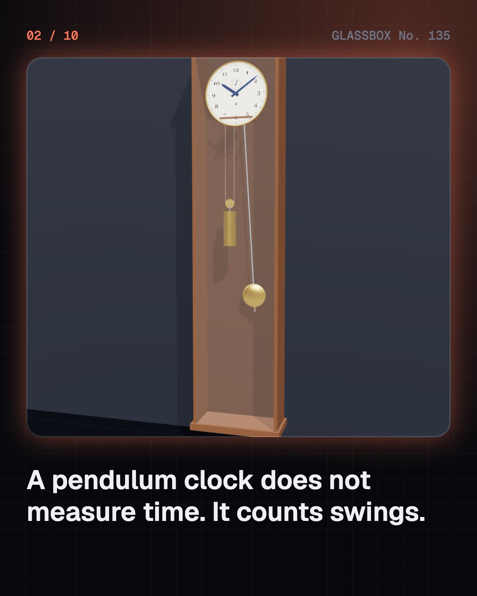
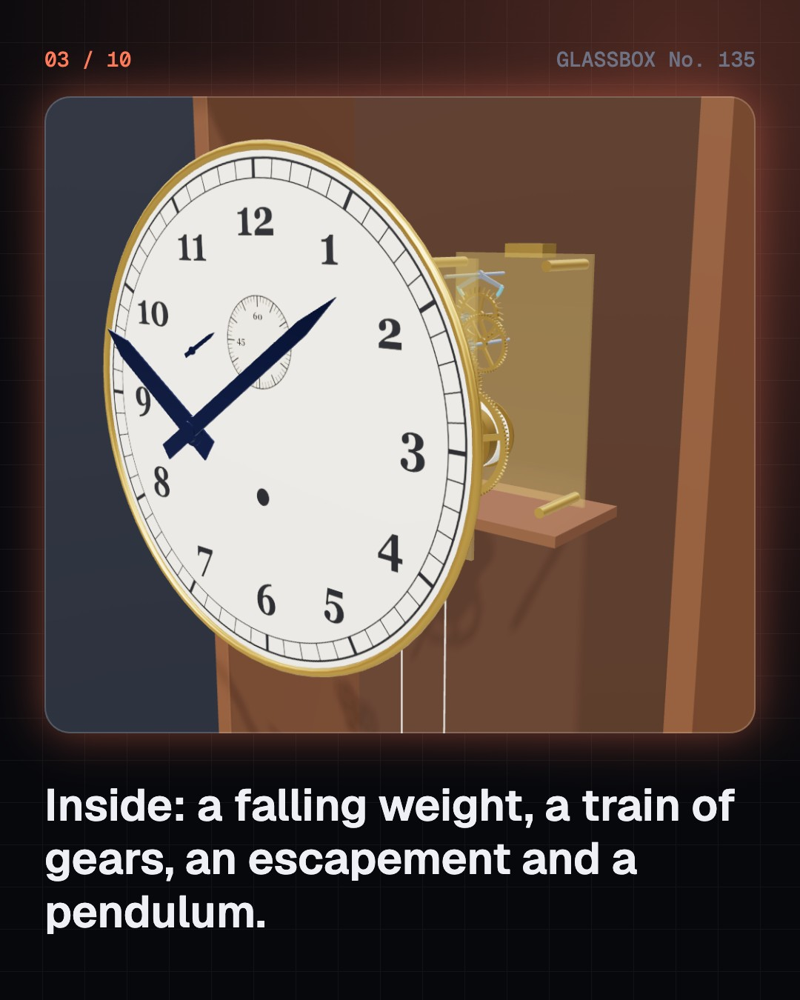
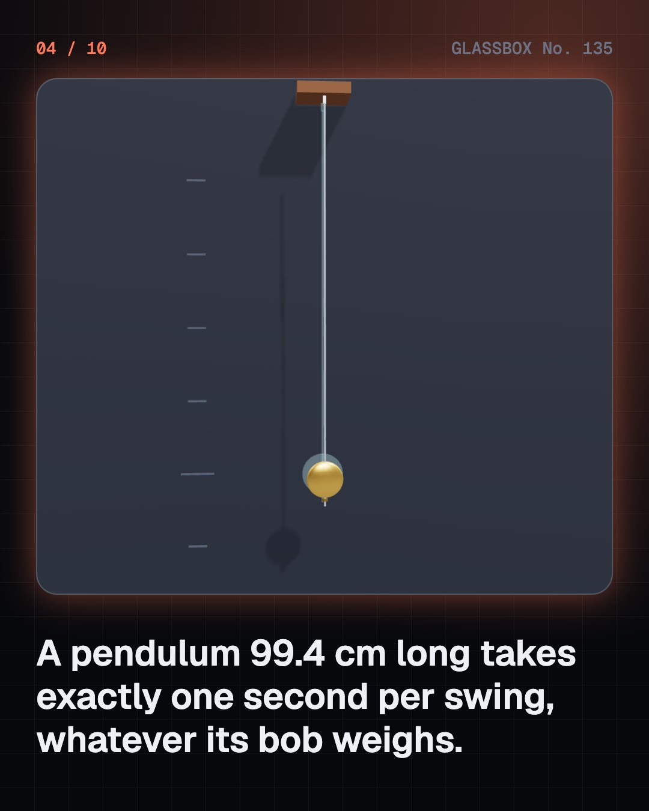

<!-- glassbox:start -->
<!-- Generated from glassbox.json by the Glassbox hub (npm run readme -- clockclear). Edit glassbox.json, not this block. -->
<p align="center"><a href="https://glassbox.how/e/clockclear/"></a></p>

<h1 align="center">ClockClear</h1>

<p align="center"><b>How does a wall clock work?</b><br>A falling weight, a train of gears, and a pendulum that lets them move one tooth per swing. Take a clock apart in 3D, follow the escapement tick by tick, and see why a hot day makes it lose ten seconds.</p>

<p align="center"><a href="https://glassbox.how/clockclear/"><b>▶ Play with it</b></a> &nbsp;·&nbsp; <a href="https://glassbox.how/e/clockclear/">Read the 60-second explainer</a> &nbsp;·&nbsp; <a href="https://glassbox.how/clockclear/glassbox/reel.mp4">Watch the 40-second video</a></p>

<p align="center">
  <a href="https://glassbox.how/e/clockclear/"></a>
  <a href="https://glassbox.how/e/clockclear/"></a>
  <a href="LICENSE"></a>
  <a href="LICENSE-CONTENT.md"></a>
  <a href="#privacy"></a>
</p>

## In 60 seconds

1. **A clock counts swings.** A pendulum clock has five parts in a row: a weight or spring for power, a train of gears, an escapement, a pendulum and the hands. It does not measure time directly. It counts the pendulum's swings, 3,600 of them an hour in this clock.
2. **The pendulum keeps the beat.** A pendulum's period is 2π times the square root of its length over gravity. Its mass does not matter, and a small swing hardly does. A pendulum 99.4 cm long takes one second per swing. Heat makes the rod longer and the clock slower, so it is tuned with a nut under the bob.
3. **The escapement: lock, push, drop.** The anchor rocks with the pendulum and catches the escape wheel's teeth on two pallets. On each swing one tooth is released, slides down a slanted face to give the pendulum a small push, and drops until the other pallet catches the next tooth. That landing is the tick.
4. **Gears do the arithmetic.** Wheels of 96, 60 and 56 teeth drive pinions of 8, 8 and 7. The ratios 12, 7.5 and 8 multiply to 720, so the escape wheel turns once a minute while the drum turns once in twelve hours. Sixteen turns of line run the clock for eight days on about 58 joules.
5. **Two hands, one centre, and a bell.** Behind the dial, four wheels (36, 36, 6 and 72 teeth) turn the hour hand exactly 12 times slower than the minute hand around the same centre. For striking, a rack falls onto a stepped cam called the snail, and the depth of the step sets how many blows the hammer gives.
6. **The clock on your wall.** Most wall clocks now replace the pendulum with a quartz crystal vibrating 32,768 times a second. A chip halves that fifteen times to one pulse a second, and each pulse flips a tiny motor half a turn. No two crystals match exactly, so clocks drift apart by seconds a week.

## Words worth knowing

| Term | Meaning |
|---|---|
| **Pendulum** | A weight on a rod that swings at a steady rate set by its length and by gravity. |
| **Period** | The time for one full swing there and back: 2π√(L/g). A 99.4 cm pendulum has a period of 2 seconds. |
| **Escapement** | The mechanism that releases the gear train one tooth per swing and gives the pendulum a small push each time. |
| **Pallet** | One of the two hard faces on the anchor that catch and release the escape wheel's teeth. |
| **Deadbeat** | An escapement whose locking faces are curved around the anchor's pivot, so the wheel stands still instead of being pushed backwards. |
| **Going train** | The gears that carry power from the weight or spring to the escape wheel, speeding up at each step. |
| **Gear ratio** | Teeth on the driving wheel divided by teeth on the pinion it drives: how many times faster the pinion turns. |
| **Motion work** | The four wheels behind the dial that turn the hour hand 12 times slower than the minute hand. |
| **Quartz movement** | A battery clock mechanism timed by a quartz crystal, with a small stepper motor turning the hands. |

## A short history

**3,500 years from a shadow on the ground in Egypt to the quartz clock on your wall and atoms that count the second.**

- **1500 BCE** · Reading the time from a shadow (Ancient Egyptians, Egypt)
- **1088** · A clock tower run by a water wheel (Su Song and his team, Kaifeng, China)
- **1283** · The first clocks that tick (Unknown clockmakers, Western Europe (an early record is at Dunstable Priory, England, 1283))
- **1656** · The pendulum clock (Christiaan Huygens and Salomon Coster, The Hague, Dutch Republic)
- **1670** · The anchor escapement (Joseph Knibb or William Clement (Robert Hooke also claimed), Oxford and London, England)
- **1734** · The giant sundial of Jaipur (Sawai Jai Singh II, Jantar Mantar, Jaipur, India)
- **1761** · A watch that found longitude (John Harrison and his son William, Portsmouth, England, to Jamaica)
- **1859** · The Great Clock of Westminster (Edmund Beckett Denison, George Airy, Edward and Frederick Dent, London, England)

The full story, with 30 moments, charts, people and 45 sources: [glassbox.how/e/clockclear/history](https://glassbox.how/e/clockclear/history/). The data lives in [`history.json`](history.json).

## Video and slides

Made with the Glassbox studio from this box's storyboard (`window.glassbox.director`). Free to reuse under CC BY 4.0.

<a href="https://glassbox.how/clockclear/glassbox/video.mp4"></a>

<p><a href="glassbox/slide-1.jpg"></a> <a href="glassbox/slide-2.jpg"></a> <a href="glassbox/slide-3.jpg"></a> <a href="glassbox/slide-4.jpg"></a></p>

| File | What | Size |
|---|---|---|
| [`glassbox/reel.mp4`](https://glassbox.how/clockclear/glassbox/reel.mp4) | Reel / Short, with captions and soundtrack | 1080×1920 |
| [`glassbox/video.mp4`](https://glassbox.how/clockclear/glassbox/video.mp4) | YouTube video, with captions and soundtrack | 1920×1080 |
| `glassbox/slide-1…10.jpg` | Instagram carousel | 1080×1350 |
| `glassbox/thumb.jpg` | YouTube thumbnail | 1280×720 |
| `glassbox/cover.jpg` | Share card and repo social preview | 1200×630 |
| [`glassbox/history-reel.mp4`](https://glassbox.how/clockclear/glassbox/history-reel.mp4) | “History in 10 moments” Reel / Short | 1080×1920 |
| `glassbox/history-slide-*.jpg` | History carousel | 1080×1350 |
| `glassbox/post.json` | Post copy and schedule used by the publish kit | |

## Privacy

This box has no accounts and no ads, and it ships its own fonts and libraries. When you run it yourself it sends nothing anywhere. On glassbox.how, the site's `/bar.js` also loads Glassbox's analytics: **Google Analytics** to count visits (it asks first in the EU, UK and Switzerland, and stays off when your browser sends Global Privacy Control or Do Not Track) and **ClickTrust** to detect bots.

It remembers a few things **in your own browser only**, and never sends them anywhere:

| Browser storage key | What it holds |
|---|---|
| `clockclear.v1` | Which chapters you have opened, your best quiz scores, and sound on or off. |

Exactly what each one sees is at [glassbox.how/privacy](https://glassbox.how/privacy/).

## Licences

- **Code:** [MIT](LICENSE). Use it, change it, ship it.
- **Explanations, text, images and videos** (`glassbox.json`, `glassbox/`): [CC BY 4.0](LICENSE-CONTENT.md). Credit “Glassbox, glassbox.how/e/clockclear”.
- **Third-party parts** keep their own licences: [three.js](https://threejs.org) (MIT), [Geist, Instrument Serif](https://openfontlicense.org) (SIL OFL 1.1).
- The Glassbox name and logo aren't covered by either licence. See the [terms](https://glassbox.how/terms/).

Found a mistake? [Open an issue](https://github.com/bdeeps/clockclear/issues). Corrections happen in public.
<!-- glassbox:end -->

## Run it

It's plain HTML, CSS and JavaScript. No build step and no dependencies. Run locally, it contacts no other website.

```bash
python3 -m http.server 8000
```

Three.js and the fonts ship in `vendor/` and `fonts/`, so it also works offline.

Then open http://localhost:8000.

## How it's built

| File | What |
|---|---|
| `index.html`, `css/app.css` | The page and its styles |
| `js/app.js`, `js/stage.js`, `js/ui.js`, `js/kit.js` | The shared Glassbox 3D engine: chapters, 3D stage, controls, quiz, video director |
| `js/clock.js`, `js/escapement.js` | ClockClear's own parts: meshing gears, the going train, dial, hands and pendulum, and the escapement's contact model (teeth against pallets) |
| `js/chapters/*.js` | One file per chapter: the 3D model, controls, text, key terms, quiz and video scenes |
| `glassbox.json` | Title, question, explainer beats, key terms, browser storage and credits shown on glassbox.how |
| `reel` in each chapter | The storyboard the Glassbox studio records into short videos |
| `glassbox/` | The published video, slides, thumbnail and post copy |
| `fonts/`, `vendor/three/` | Self-hosted Geist and Instrument Serif (SIL OFL 1.1) and three.js (MIT) |
